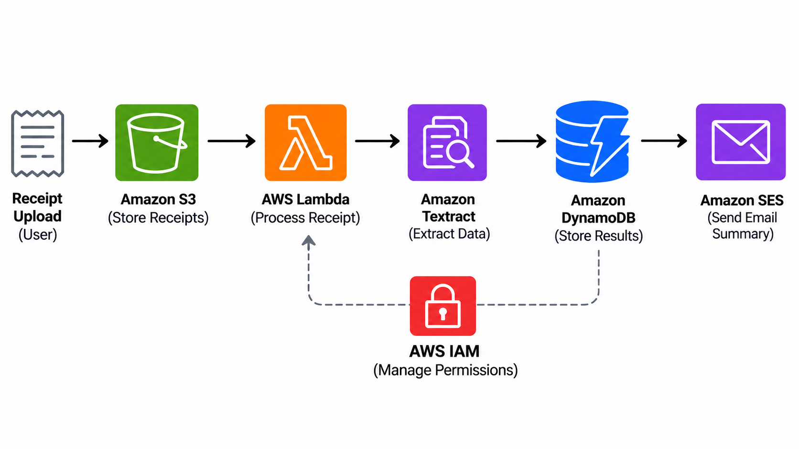
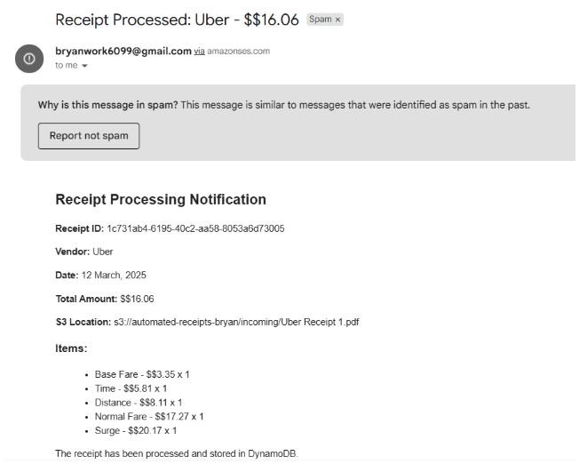
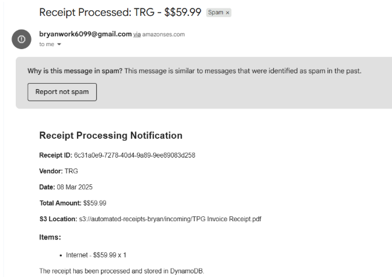
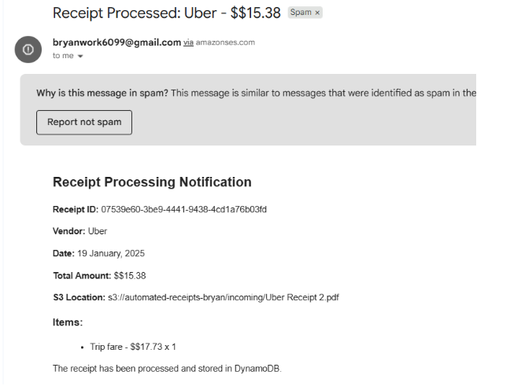
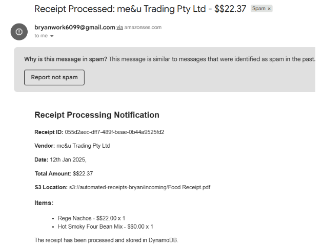
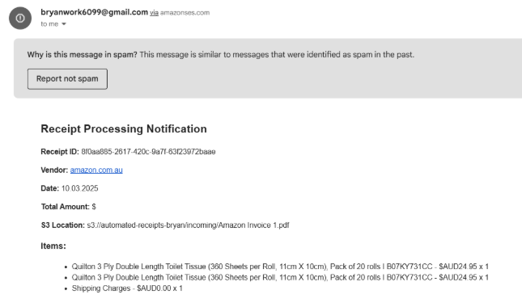
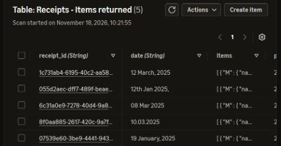

# Automated AWS Receipt Processing System

An event-driven, serverless receipt processing application built using AWS services. The system automatically processes uploaded receipts, extracts relevant information using Amazon Textract, stores the extracted data in Amazon DynamoDB, and sends email notifications through Amazon SES.

## Project Overview

This project demonstrates how AWS services can be integrated to automate receipt processing without requiring manual data entry.

When a user uploads a receipt to an Amazon S3 bucket, an event notification triggers an AWS Lambda function. Lambda then uses Amazon Textract to analyze the receipt, extracts important information, stores the results in DynamoDB, and sends an email summary using Amazon SES.

## Architecture Overview

The following diagram illustrates the workflow and interaction between the AWS services used in this project.

### Workflow

1. **Receipt Upload:** A user uploads a receipt to the `incoming/` folder in Amazon S3.
2. **Event Notification:** Amazon S3 detects the new object and triggers the Lambda function.
3. **Receipt Processing:** AWS Lambda retrieves the uploaded receipt and initiates document analysis.
4. **Data Extraction:** Amazon Textract uses `AnalyzeExpense` to extract receipt information.
5. **Data Storage:** AWS Lambda saves the extracted information in the Amazon DynamoDB table.
6. **Email Notification:** Amazon SES sends an email summary containing the processed receipt information.

## AWS Services Used

| AWS Service | Purpose |
|---|---|
| Amazon S3 | Stores uploaded receipt images and documents |
| AWS Lambda | Automates the receipt processing workflow |
| Amazon Textract | Extracts information from receipts using AnalyzeExpense |
| Amazon DynamoDB | Stores extracted receipt information |
| Amazon SES | Sends email notifications and processing summaries |
| AWS IAM | Manages permissions for Lambda to access AWS services |

## Architecture Components

### 1. Amazon S3 – Receipt Storage

- S3 bucket: `automated-receipts-bryan`
- Upload location: `incoming/`
- Stores receipt images and documents.
- Configured an event notification to trigger Lambda when new objects are created under the `incoming/` prefix.

### 2. AWS Lambda – Automation

- Function name: `ReceiptProcessor`
- Runtime: Python 3.9
- Execution role: `ReceiptProcessingLambdaRole`
- Timeout: 3 minutes

The Lambda function coordinates the entire workflow:

- Receives the S3 event notification.
- Retrieves the uploaded receipt.
- Calls Amazon Textract to analyze the document.
- Extracts relevant receipt information.
- Saves the extracted data in DynamoDB.
- Sends an email summary through Amazon SES.

### 3. Amazon Textract – Data Extraction

Uses the `AnalyzeExpense` API to identify and extract information from receipts.

Examples of extracted information:

- Vendor name
- Receipt date
- Total amount
- Item descriptions
- Item prices
- Item quantities

### 4. Amazon DynamoDB – Data Storage

- Table name: `Receipts`
- Partition key: `receipt_id` (String)
- Sort key: `date` (String)

Stores the extracted receipt information in a structured format for future retrieval and reference.

### 5. Amazon SES – Email Notification

Amazon Simple Email Service (SES) sends an HTML email summary after a receipt has been processed.

The notification provides information extracted from the uploaded receipt.

### 6. AWS IAM – Access Management

Created an IAM execution role named `ReceiptProcessingLambdaRole` to allow Lambda to interact with the required AWS services.

Permissions include access to:

- Amazon S3
- Amazon Textract
- Amazon DynamoDB
- Amazon SES
- AWS Lambda basic execution and logging

**Security note:** The initial implementation uses AWS-managed policies for functionality and testing. For production environments, replace broad permissions with least-privilege policies that grant only the required actions and resources.

## Technologies Used

- Python 3.9
- Boto3 (AWS SDK for Python)
- Amazon S3
- AWS Lambda
- Amazon Textract
- Amazon DynamoDB
- Amazon SES
- AWS IAM

## Project Results

The application successfully demonstrates an automated receipt processing workflow:

- Uploading a receipt to Amazon S3 triggers the processing workflow.
- Amazon Textract extracts relevant information from the receipt.
- AWS Lambda processes and organizes the extracted information.
- Amazon DynamoDB stores the receipt records.
- Amazon SES sends an email notification with the processing summary.

## Screenshots & Results

The following screenshots demonstrate the successful execution of the receipt processing application.

### 1. Receipt Processing Results

Below are examples of the six receipts processed by the application.

**Receipt 1**

**Receipt 2**

**Receipt 3**

**Receipt 4**

**Receipt 5**

### 2. Amazon DynamoDB – Stored Receipt Records

The extracted receipt information is successfully stored in the Amazon DynamoDB `Receipts` table.

These records demonstrate how the application organizes and stores receipt information for future retrieval.

## Project Objectives

- Build an event-driven serverless application using AWS.
- Automate receipt information extraction using Amazon Textract.
- Integrate AWS Lambda with multiple AWS services.
- Store structured information using Amazon DynamoDB.
- Implement automated email notifications using Amazon SES.
- Understand AWS IAM roles and service permissions.

## Security Considerations

- Avoid committing AWS access keys, secret keys, or credentials.
- Do not expose personal email addresses in public configuration files.
- Use placeholder values for sensitive environment variables.
- Apply least-privilege IAM permissions.
- Keep sensitive receipt information out of public repositories.

---

**Project:** Automated AWS Receipt Processing System  
**Category:** AWS | Serverless Computing | Automation | Document Processing
